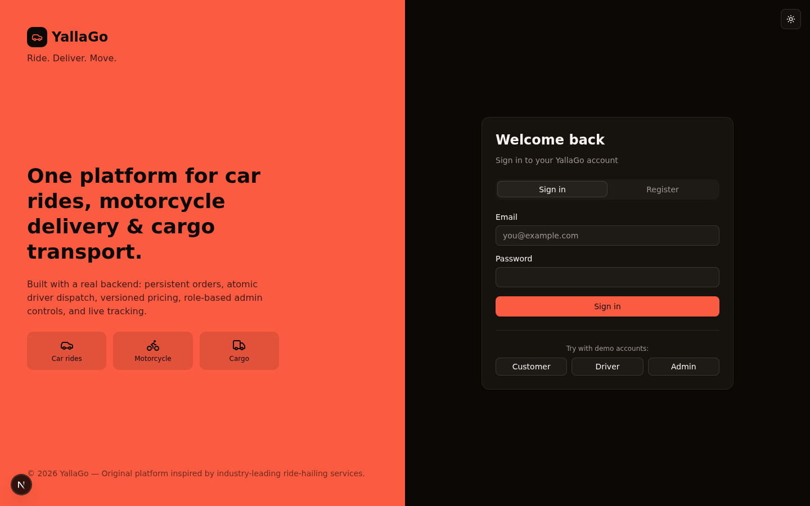
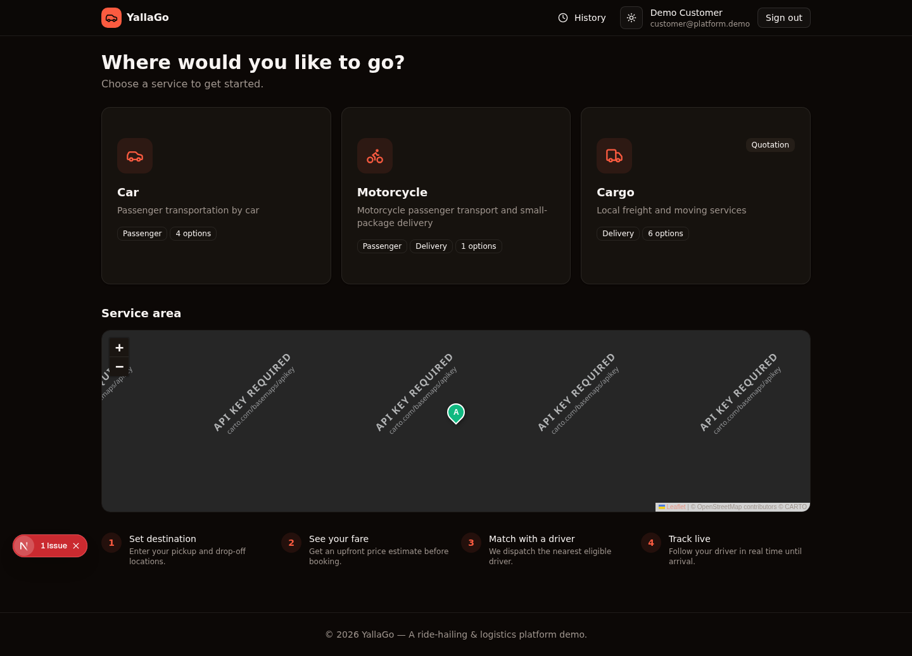
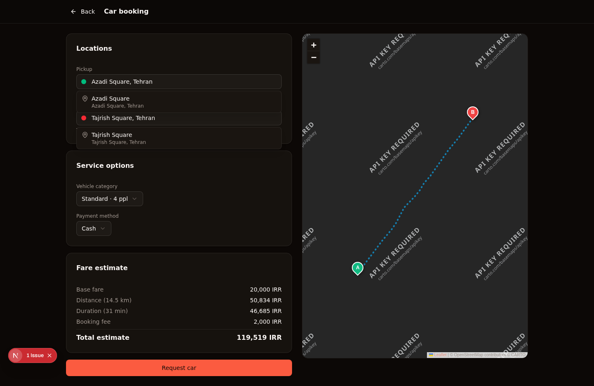
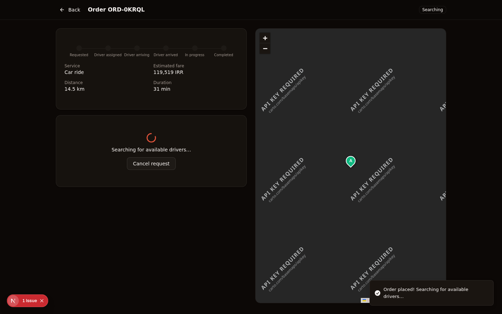
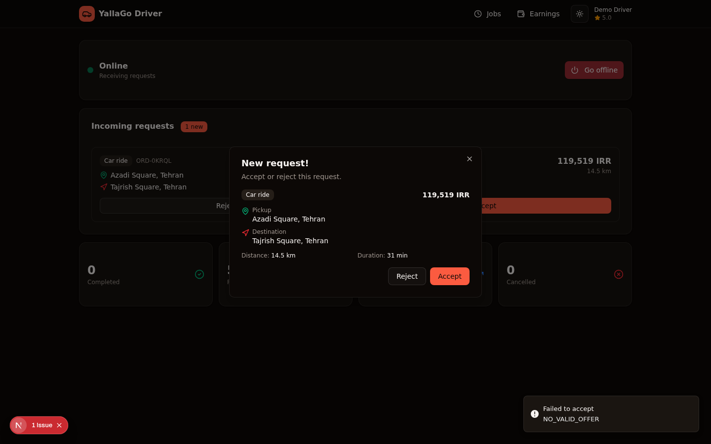
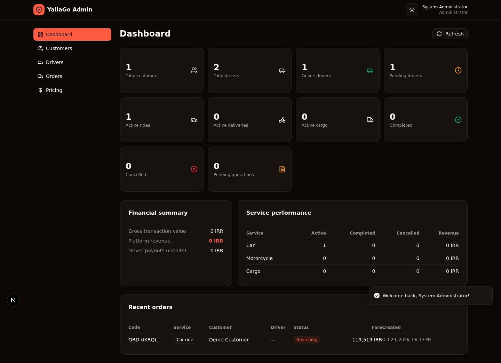
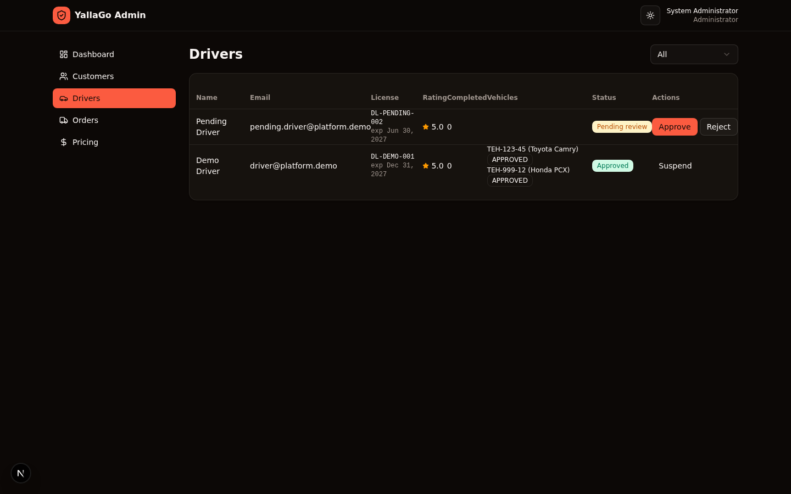
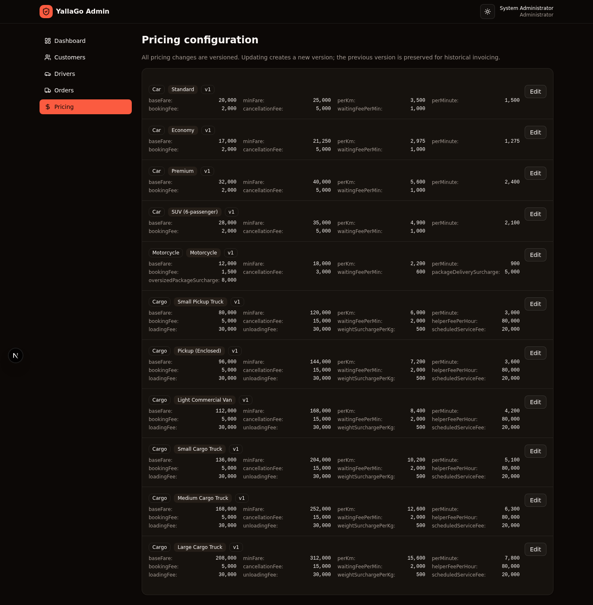
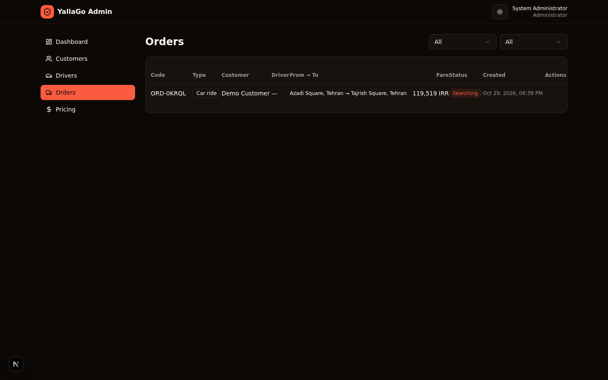
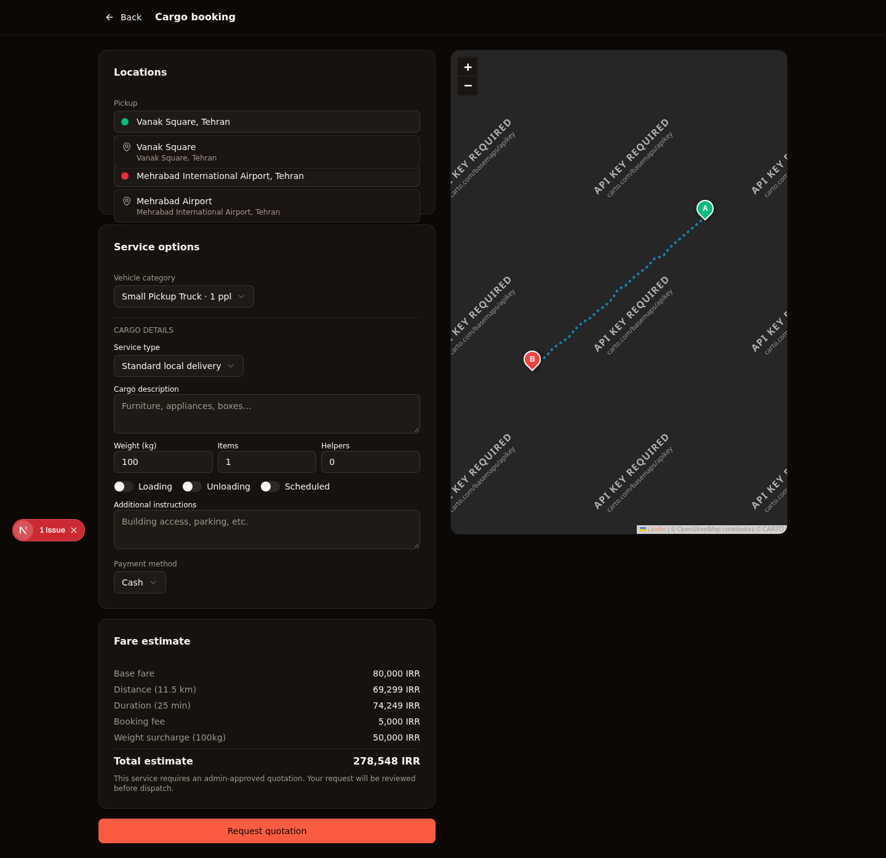

# YallaGo

**Ride, deliver, move — one platform for car rides, motorcycle delivery, and local cargo.**

> **Status: Demo / Prototype.** This is a functional reference implementation, not a live product. Every order, driver, payment, and ledger entry below is synthetic — generated locally from a seeded SQLite database. No real money moves, no real drivers are dispatched, no real map API keys are required to run it.

---

## Problem

Building a ride-hailing + logistics platform from scratch touches many hard problems at once:

- **Atomic driver dispatch** — two drivers accepting the same order at the same instant must not both win.
- **Configurable pricing** — base fare, per-km, per-minute, surcharges, commission, peak multipliers — and every change must be versioned so historical invoices never silently change.
- **Three service types under one roof** — car rides, motorcycle delivery, and cargo freight each have different state machines, different pricing rules, and different dispatch eligibility, but share one order model.
- **Real-time tracking** — a customer should see their driver move on the map; a driver should see incoming requests without polling the server every second.
- **Role-separated surfaces** — customer, driver, and admin see the same data through completely different lenses, with strict object-level authorization.
- **Auditable operations** — every state transition, every pricing change, every admin action has to be reconstructable later.

Most open-source ride-hailing demos solve only the surface layer — a pretty UI calling a fake API. YallaGo solves the underlying systems problems instead.

---

## Solution

YallaGo is a modular monolith built on Next.js 16 with a real Prisma-backed persistence layer, a Socket.io mini-service for live updates, and a state-machine-driven order engine. The UI is **dark-mode-first by design** — see [`docs/DECISIONS.md`](docs/DECISIONS.md) for the rationale.

**What's actually wired up end-to-end:**

- A customer creates an order → backend validates, computes a backend-side fare estimate, persists the order, and triggers dispatch.
- The dispatch engine finds eligible online drivers, ranks by distance, and atomically assigns via a database transaction with a conditional `UPDATE` (so concurrent accepts are safe).
- The assigned driver's location is broadcast over Socket.io only to the customer who owns that order — never to other customers.
- Every state transition (`REQUESTED → SEARCHING → DRIVER_ASSIGNED → ARRIVING → ARRIVED → IN_PROGRESS → COMPLETED`) is validated against an explicit allow-list and recorded as an `OrderEvent`.
- On completion, the financial ledger writes three entries — `CUSTOMER_CHARGE`, `DRIVER_CREDIT`, `PLATFORM_COMMISSION` — using the pricing config version that was active when the order was created, not the current one.
- An admin can change pricing, suspend a driver, approve a cargo quotation, or override an order status — every action hits the audit log.

---

## Features

### Implemented and tested

- 🔐 **Authentication** — session cookies, PBKDF2-hashed passwords, three roles (Customer / Driver / Admin), object-level authorization
- 🚗 **Three service categories** — Car (4 vehicle types), Motorcycle (passenger + package delivery), Cargo (6 vehicle types, quotation workflow)
- 💸 **Versioned pricing engine** — backend fare calculation with full breakdown; every update creates a new version and deactivates the old one
- 🛰 **Atomic driver dispatch** — database transaction + conditional update prevents duplicate assignment under concurrent accepts
- 📦 **Order state machines** — service-specific lifecycles (ride, delivery, cargo) with server-side transition validation and full event audit trail
- 🗺 **Provider-independent maps** — Leaflet + OpenStreetMap tiles by default, swappable to Google Maps / Mapbox / OSRM via the `src/lib/geo.ts` abstraction
- ⚡ **Real-time updates** — Socket.io mini-service (port 3003) with room-isolated driver location broadcasts
- 📊 **Admin dashboard** — KPIs, customer management, driver verification, order management with filters, cargo quotation approval, versioned pricing editor with audit trail
- 💰 **Financial ledger** — double-entry-style records for charges, driver credits, platform commission
- ⭐ **Ratings** — 5-star feedback that updates the driver's aggregate rating
- 🌗 **Dark-mode-first UI** — premium charcoal palette with warm terracotta accent; one-click theme toggle in every header
- 🎨 **Original brand identity** — built from scratch, not copying any existing product's trademarks or visual assets

### Mocked for development

- Address geocoding (preset Tehran locations) — swap in Google Maps / Mapbox via `src/lib/geo.ts`
- Route polylines (quadratic interpolation) — swap in OSRM for real road-following routes
- Payment provider (`MOCK` adapter) — Stripe / PayPal / local-gateway adapters stubbed
- SMS / push notifications — Notification model exists, no real provider

### Not implemented (see [`docs/LIMITATIONS.md`](docs/LIMITATIONS.md))

Background job system (offer expiration uses client polling), OTP phone verification, native mobile apps, RTL / Persian localization, automated test suite, Docker deployment files, real webhook handling.

---

## Screenshots

_All captured from the demo running locally at 1440 × 900 in dark mode. Every figure, account, order, and ledger entry is synthetic. The UI is dark-mode-first by design; see [`docs/DECISIONS.md`](docs/DECISIONS.md)._

| Login screen | Customer home — three service categories |
|---|---|
|  |  |
| **Customer — car booking with live map & fare estimate** | **Customer — live ride tracking with status timeline** |
|  |  |
| **Driver — incoming request modal (accept / reject)** | **Driver — active job with state-machine action button** |
|  |  |
| **Admin dashboard — KPIs + service performance** | **Admin — driver verification queue (approve / reject)** |
|  |  |
| **Admin — versioned pricing editor** | **Admin — order management with filters** |
|  |  |
| **Customer — cargo booking form (with helpers, loading, scheduling)** |
|  |

_Desktop-sized screens (1440 × 900). All data is synthetic._

---

## Architecture

```
┌───────────────────────────────────────────────────────────────┐
│                   Browser (single-page app)                    │
│   /  →  AuthScreen  →  CustomerApp | DriverApp | AdminApp      │
└──────────────────────────┬─────────────────────────────────────┘
                           │ HTTPS + HTTP-only session cookie
┌──────────────────────────▼─────────────────────────────────────┐
│              Next.js 16 App (port 3000)                        │
│   ┌────────────────┐  ┌────────────────┐  ┌────────────────┐   │
│   │  React pages   │  │  /api/* routes │  │  Server libs   │   │
│   │  (App Router)  │──│  (Route        │──│  auth.ts       │   │
│   │  shadcn/ui     │  │   Handlers)    │  │  dispatch.ts   │   │
│   └────────────────┘  └───────┬────────┘  │  pricing.ts    │   │
│                               │           │  geo.ts        │   │
│                               │           │  db.ts         │   │
└───────────────────────────────┼───────────┴────────────────┘
                                │
            ┌───────────────────▼───────────────────┐
            │   Prisma + SQLite (db/custom.db)       │
            │   20+ models, indexed for dispatch     │
            └────────────────────────────────────────┘
            ┌────────────────────────────────────────┐
            │   Socket.io mini-service (port 3003)    │
            │   ↳ gateway: /?XTransformPort=3003      │
            │   ↳ room-isolated driver-location       │
            │     broadcasts (only to active-order    │
            │     customer + admins)                  │
            └────────────────────────────────────────┘
```

**Why a modular monolith?** Domain boundaries are enforced at the file/module level (`auth`, `dispatch`, `pricing`, `geo`) rather than via microservices. This keeps operational complexity low while preserving the ability to extract services later. See [`docs/ARCHITECTURE.md`](docs/ARCHITECTURE.md) and [`docs/DECISIONS.md`](docs/DECISIONS.md) for the full rationale.

### Layers

| Layer | Location | Responsibility |
|---|---|---|
| Presentation | `src/components/{customer,driver,admin,shared,map}/` | React UI, shadcn/ui components, Leaflet map |
| API | `src/app/api/...` | Route handlers — auth, validation, role checks |
| Domain | `src/lib/{dispatch,pricing,geo,auth,crypto}.ts` | Pure TypeScript — state machines, pricing, dispatch |
| Persistence | `prisma/schema.prisma`, `src/lib/db.ts` | Prisma + SQLite |
| Real-time | `mini-services/realtime/` | Socket.io server (port 3003) + emit endpoint (port 3004) |

---

## Tech Stack

- **Framework**: Next.js 16 (App Router) — required by the environment
- **Language**: TypeScript 5 (strict)
- **Styling**: Tailwind CSS 4 with shadcn/ui (New York style)
- **Database**: Prisma ORM + SQLite (PostgreSQL-ready schema)
- **Real-time**: Socket.io (mini-service on port 3003)
- **Maps**: Leaflet + OpenStreetMap / CARTO dark tiles
- **Auth**: HTTP-only session cookies, PBKDF2-sha512 password hashing
- **State**: Zustand (client) + TanStack Query (server)
- **Forms**: React Hook Form + Zod
- **Notifications**: Sonner (in-app toasts)
- **Theming**: next-themes (dark-mode-first)

No external API keys required for development — all integrations (maps, geocoding, payments) are mocked or use free tiers.

---

## Demo

### Demo credentials

| Role | Email | Password |
|---|---|---|
| Customer | `customer@platform.demo` | `customer123` |
| Driver | `driver@platform.demo` | `driver123` |
| Admin | `admin@platform.demo` | `admin123` |

A pending driver (`pending.driver@platform.demo` / `driver123`) is also seeded for testing the admin approval workflow. Pending drivers cannot log in until approved.

### Quick start

```bash
# 1. Install dependencies
bun install

# 2. Initialize the database and seed demo data
bun run db:push
bun run scripts/seed.ts

# 3. Start the realtime WebSocket service (background)
cd mini-services/realtime && bun install && bun run dev &
cd ../..

# 4. Start the main Next.js app (port 3000)
bun run dev
```

Open `http://localhost:3000` and log in with one of the demo accounts above.

### Try the full flow

1. Sign in as the **customer** → select **Car** → search "Azadi" for pickup and "Tajrish" for destination → see fare estimate → click **Request car**.
2. Sign out and sign in as the **driver** → toggle **Go online** → a request modal appears → click **Accept** → advance through **Start navigating → Mark arrived → Start trip → Complete trip**.
3. Sign in as **admin** → see the new order in the dashboard → visit **Drivers** tab to approve the pending driver → visit **Pricing** tab to edit a config (creates a new version).

### Useful scripts

| Script | Purpose |
|---|---|
| `bun run db:push` | Create/migrate SQLite schema |
| `bun run scripts/seed.ts` | Seed service catalog, pricing, demo users |
| `bun run scripts/refresh-driver.ts` | Refresh demo driver's online status |
| `bun run scripts/clean-tx.ts` | Wipe orders/events/ledger but keep users & config |
| `bun run lint` | ESLint check |

No environment variables are required for development. The `.env` file contains only `DATABASE_URL=file:/home/z/my-project/db/custom.db`.

---

## Project Structure

```
.
├── prisma/
│   └── schema.prisma              # 20+ models: User, Driver, Order, PricingConfiguration, LedgerEntry…
├── scripts/
│   ├── seed.ts                    # Database seeder (services, pricing, demo users)
│   ├── refresh-driver.ts          # Refresh demo driver's online status
│   └── clean-tx.ts                # Wipe transactional data
├── src/
│   ├── app/
│   │   ├── api/                   # 30+ route handlers under /api/{auth,services,pricing,orders,drivers,admin,geo,notifications}/
│   │   ├── page.tsx               # Root router (auth → role-based app)
│   │   ├── layout.tsx             # ThemeProvider + dark-mode-first bootstrap
│   │   └── globals.css            # Tailwind tokens + dark theme palette + leaflet dark styles
│   ├── components/
│   │   ├── customer/customer-app.tsx
│   │   ├── driver/driver-app.tsx
│   │   ├── admin/admin-app.tsx
│   │   ├── shared/
│   │   │   ├── auth-screen.tsx
│   │   │   ├── auth-provider.tsx
│   │   │   ├── theme-provider.tsx
│   │   │   └── theme-toggle.tsx
│   │   └── map/MapView.tsx        # Leaflet wrapper, theme-aware tiles
│   ├── lib/
│   │   ├── auth.ts                # Session management
│   │   ├── crypto.ts              # PBKDF2 password hashing
│   │   ├── dispatch.ts            # Order engine + state machine + atomic dispatch
│   │   ├── pricing.ts             # Versioned pricing engine
│   │   ├── geo.ts                 # Provider-independent geocoding/routing
│   │   ├── api.ts                 # API route wrapper
│   │   ├── api-client.ts          # Frontend typed API client
│   │   ├── realtime-client.ts     # Socket.io browser client
│   │   ├── format.ts              # Shared formatters
│   │   └── db.ts                  # Prisma client
│   └── stores/app-store.ts        # Zustand UI state
├── mini-services/
│   └── realtime/                  # Socket.io mini-service (port 3003)
├── docs/
│   ├── screenshots/               # Dark-mode screenshots (12 PNGs)
│   ├── ARCHITECTURE.md            # Layer-by-layer architecture
│   ├── DECISIONS.md               # Design rationale (dark-mode-first, modular monolith, etc.)
│   ├── DATABASE_SCHEMA.md         # Schema reference
│   ├── API_REFERENCE.md           # All 30+ endpoints
│   ├── IMPLEMENTATION_PLAN.md     # Phase-by-phase status
│   ├── SECURITY.md                # Threat model & gaps
│   └── LIMITATIONS.md             # What's not implemented
├── README.md
├── CHANGELOG.md
└── package.json
```

---

## Documentation

- [`docs/ARCHITECTURE.md`](docs/ARCHITECTURE.md) — Layer-by-layer architecture, request flow, scaling considerations
- [`docs/DECISIONS.md`](docs/DECISIONS.md) — Why dark-mode-first, why a modular monolith, why Socket.io, why Prisma + SQLite
- [`docs/DATABASE_SCHEMA.md`](docs/DATABASE_SCHEMA.md) — All 20+ models, indexes, constraints, foreign keys
- [`docs/API_REFERENCE.md`](docs/API_REFERENCE.md) — Every endpoint with request/response shapes
- [`docs/IMPLEMENTATION_PLAN.md`](docs/IMPLEMENTATION_PLAN.md) — Phase-by-phase implementation status
- [`docs/SECURITY.md`](docs/SECURITY.md) — Threat model, security gaps, hardening checklist
- [`docs/LIMITATIONS.md`](docs/LIMITATIONS.md) — What's mocked, what's missing, what's blocked

---

## Business & Product Overview

This is a **portfolio reference implementation**, not a commercial product. It demonstrates that the hard systems problems of a ride-hailing + logistics platform — atomic dispatch, versioned pricing, state-machine validation, real-time tracking, role-separated authorization, audit trails — can be solved cleanly in a single Next.js codebase without microservices.

### If this were a real product

- **Target customers**: Regional ride-hailing operators, last-mile delivery companies, local freight & moving businesses — especially in markets underserved by global players.
- **Differentiation**: Three service types (car + moto + cargo) on one platform; configurable pricing and service areas per region; provider-independent map / payment / SMS integrations so deployment in any country is feasible.
- **Monetization**: Platform commission per completed order (default 15–20%, configurable per service category and region).
- **Operating model**: Drivers are independent contractors approved via document verification; payouts are computed from ledger entries.

### What's missing for production

Real payment gateway with webhook handling, real SMS OTP, real push notifications, background job system (BullMQ), PostgreSQL with PostGIS for geographic dispatch, rate limiting, CSRF protection, automated test suite, Docker deployment, native mobile apps, RTL localization. See [`docs/LIMITATIONS.md`](docs/LIMITATIONS.md).

---

## Limitations

YallaGo is a **demo / prototype**. The following are intentionally not implemented:

- **No real money moves.** The payment provider is `MOCK`. No card is charged. The adapter pattern is in place for Stripe / PayPal / local gateways.
- **No real drivers are dispatched.** Eligibility is computed from a seeded `DriverLocation` table. The "online" driver is a demo account refreshed via `scripts/refresh-driver.ts`.
- **No real map API calls.** Address search uses preset Tehran locations; route polylines are quadratic interpolations. Swap in Google Maps / Mapbox / OSRM via `src/lib/geo.ts`.
- **No background jobs.** Offer expiration uses client-side polling. Production should add BullMQ.
- **No OTP / SMS verification.** Phone numbers are stored but not verified.
- **No native mobile apps.** This is a responsive PWA. Native iOS / Android would require React Native.
- **No RTL / Persian localization.** Language field exists in the schema, but the UI is English-only.
- **No automated tests.** The platform has been manually verified end-to-end; unit / integration test suite is a TODO.
- **No Docker / CI.** Runs via `bun run dev` locally. Production deployment files are a TODO.
- **SQLite.** Suitable for demo. Production should use PostgreSQL with PostGIS.

Full list: [`docs/LIMITATIONS.md`](docs/LIMITATIONS.md).

---

## Portfolio Case Study

This project was built as a demonstration of how to architect a complex multi-service transportation platform in a single Next.js codebase. The goal was to solve the underlying systems problems (atomic dispatch, versioned pricing, state machines, real-time tracking, role separation) rather than to ship a pixel-perfect UI clone of any existing product.

**Branding**: The name "YallaGo", the warm terracotta accent color, the dark-mode-first palette, and all UI copy are original work. No existing product's trademarks, copyrighted assets, or visual identity were copied. Snapp is referenced in internal documentation only as a functional inspiration for the scope of services (car + moto + cargo on one platform).

**Time to build**: Single session, end-to-end, including schema design, 30+ API routes, three full UIs, real-time service, dark-mode polish, screenshots, and documentation.

**Verified workflows**: Customer registration → order creation → driver accept → state machine → completion → rating → ledger entries → admin dashboard reflection. Concurrency tested (two simultaneous accepts → only one wins).

---

## License

MIT — see [`LICENSE`](LICENSE). All code is original work.

---

## About

YallaGo is a dark-mode-first ride-hailing & logistics platform demo. It is not a live product. Every figure, account, order, and ledger entry is synthetic, generated locally from a seeded SQLite database. No real money moves, no real drivers are dispatched, no real map API keys are required to run it.

_Status: Demo / Prototype._
